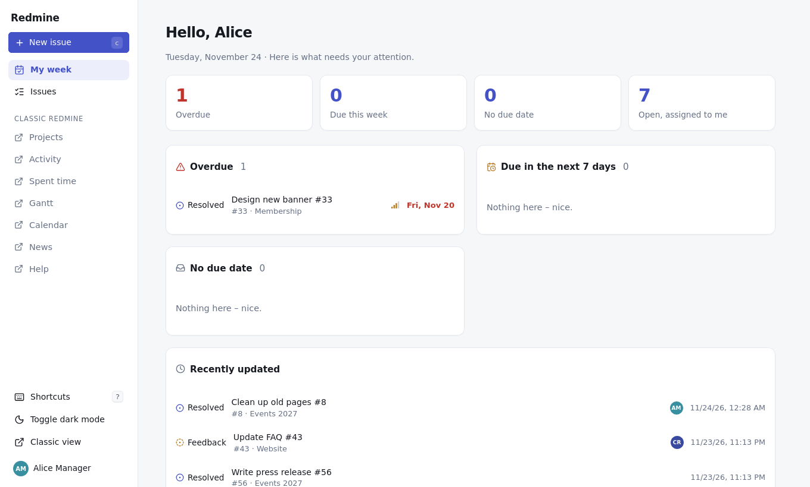
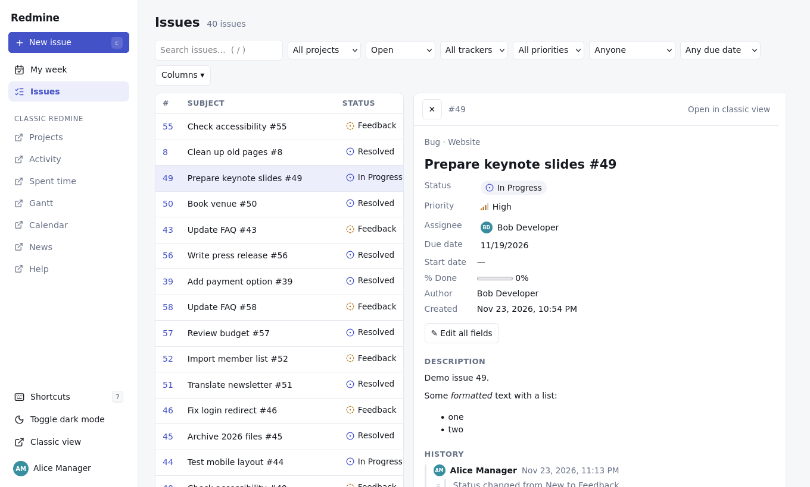
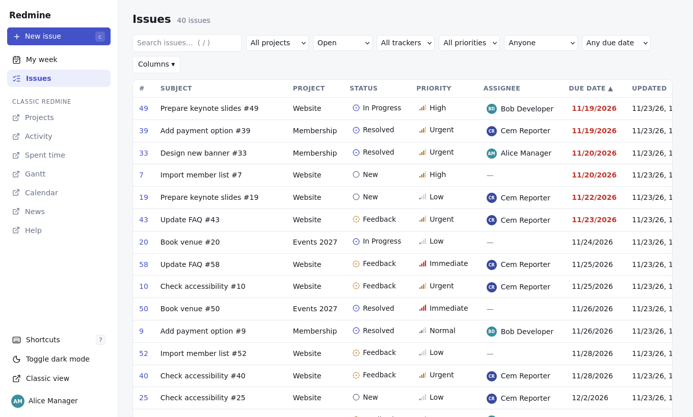
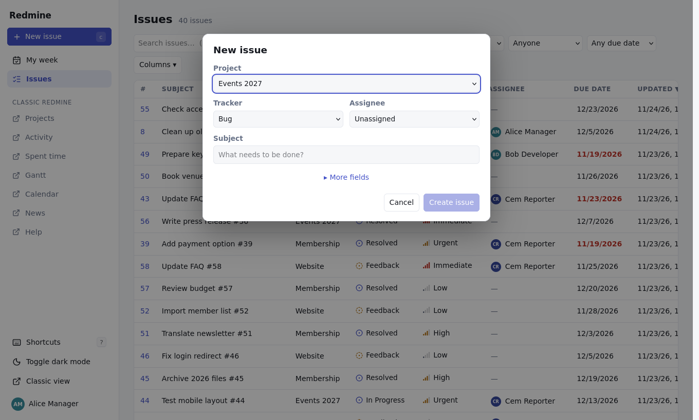
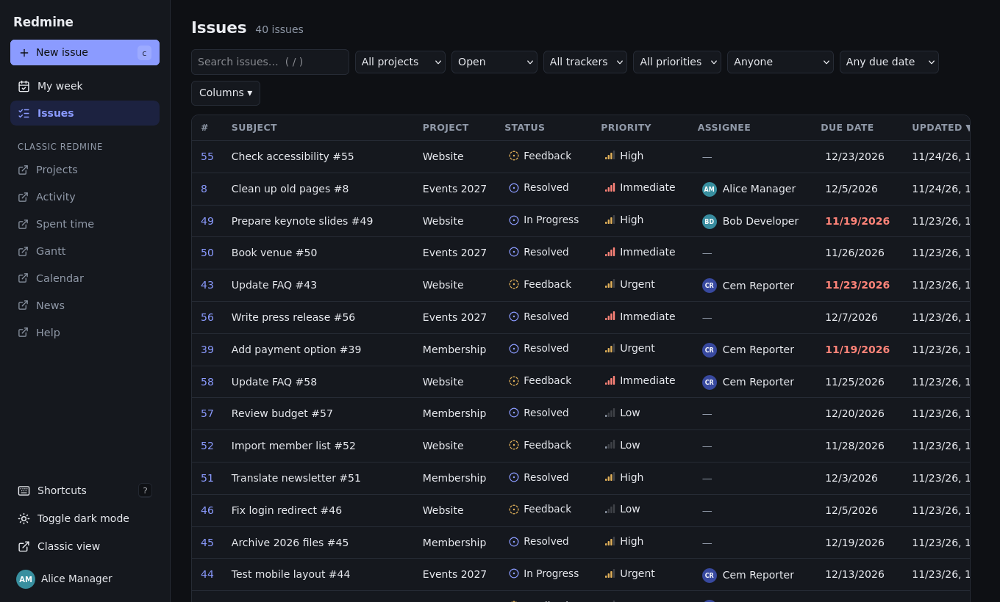
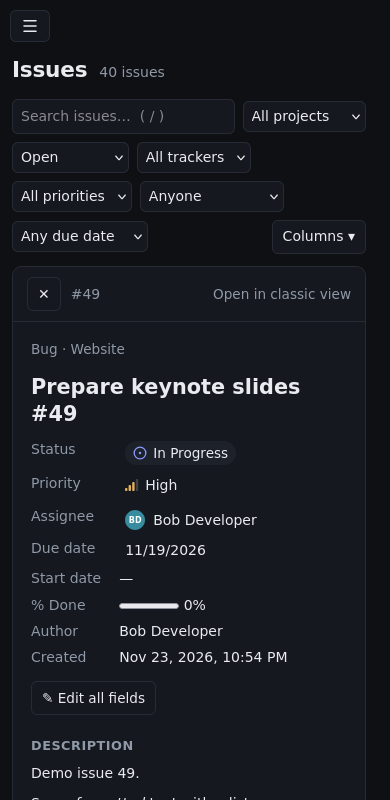

# Redmine Modern UI

A fast, modern single-page interface for [Redmine](https://www.redmine.org) – in the spirit of Linear or OpenProject –
delivered as an ordinary Redmine plugin. **Redmine stays the engine:** data, permissions and workflow rules still come
from Redmine; the plugin only adds a new front end under `/app`.

*[Deutsche Kurzfassung weiter unten.](#deutsch)*

| Start page "My week" | Issue list with split view |
|---|---|
|  |  |

| Issue list |
|---|
|  |

| Quick create | Dark mode | Mobile |
|---|---|---|
|  |  |  |

(All screenshots show fictional demo data.)

## Features

- **Start page "My week"** – overdue, due soon, without due date and recently updated issues at a glance.
- **Sidebar navigation** with links to everything the new UI does not replace yet. The links come from Redmine's own
  menus, so pages added by other plugins show up as well.
- **Issue table** – filters (project, status, tracker, priority, assignee, search), sortable columns, column chooser,
  paging, shareable URLs, **inline editing** of status (workflow aware), priority, assignee and due date.
- **Split view** – list on the left, details on the right: description, fields, history, attachments, comments
  (including private ones).
- **Edit dialog** – all fields the user may change (role and workflow aware), including custom fields.
- **Quick create** – a small dialog (`c`) with the essentials, more fields on demand.
- Dark mode, responsive layout, keyboard shortcuts (press `?`), accessible dialogs.
- **German, English and Turkish** – follows the user's Redmine language. Easy to extend.
- Optional **redirect after login** to the new UI (admin switch, opt-out per user under *My account*).
- Links in both directions: *New interface* in the classic menu, *Classic view* in the new UI.

## Requirements

| | |
|---|---|
| Redmine | **7.0** (tested with 7.0.3) and **6.1** (tested with 6.1.6) |
| Database | any supported by Redmine (tests run on SQLite, production use on MySQL) |
| Extra gems / migrations / Node.js on the server | **none** |

Works independently of the installed theme and with Redmine in a sub-directory (`https://example.org/redmine/`).

## Installation

```bash
cd /path/to/redmine/plugins
git clone https://github.com/baysal73/redmine_modern_ui.git
# restart Redmine
```

Or download the release package (`redmine_modern_ui-vX.Y.Z.zip`) and unpack it into `plugins/`.
The built front end is part of the repository – you do **not** need Node.js.

Then open `https://your-redmine/app` (or follow *New interface* in the top menu).

### Docker

Mount the plugin folder into the container: `-v ./redmine_modern_ui:/usr/src/redmine/plugins/redmine_modern_ui`
and restart the container. Redmine in production mode caches assets, so restart after every update.

## Configuration

*Administration → Plugins → Redmine Modern UI → Configure*

| Setting | Default | Meaning |
|---|---|---|
| Redirect to the new interface after login | on | Users may opt out under *My account* (stored in their user preferences). A `back_url` (deep link) always wins. |
| Path of the new interface | `app` | Needs a Redmine restart. |

## How it works

- `/app` serves a small HTML shell behind the **normal Redmine login**. Same session, same rights.
- The app talks to JSON endpoints under `/app/api/…`. They reuse Redmine's own models and checks
  (`Issue.visible`, `allowed_to?`, `safe_attributes`, workflow transitions). Writes need the CSRF token.
  No API key is stored or sent in the browser.
- Issue descriptions and comments are rendered **on the server** by Redmine's own (sanitising) text formatter.
- The plugin extends Redmine through routes, hooks and `prepend` only. **No core changes.**

> Why not Redmine's REST API? Redmine ignores the browser session for `*.json` requests and requires an API key, which
> must never be shipped to a browser. The plugin therefore has its own small endpoints on plain URLs.

## Update

```bash
cd /path/to/redmine/plugins/redmine_modern_ui
git pull        # or unpack the new release over the old one
# restart Redmine
```

## Uninstall

1. Stop Redmine, delete `plugins/redmine_modern_ui`, start Redmine.

There are no database migrations to roll back. The only data the plugin writes are two optional keys in the plugin
settings and the per-user opt-out flag inside the user preferences; both are harmless if left behind.

## Development

See [CONTRIBUTING.md](CONTRIBUTING.md) for the dev setup (Docker, demo data, building the front end) and the tests.
Front end sources: `frontend/` (Vue 3, TypeScript, Vite, Tailwind CSS, Lucide icons). Server code: `app/`, `lib/`.

## Roadmap

Gantt chart with drag & drop, time tracking, documents/files, notifications.
The structure (one API controller and one Vue view per module) is prepared for them.

## License

[GPL-2.0-or-later](LICENSE), like Redmine. Third-party libraries: [THIRD_PARTY_LICENSES.md](THIRD_PARTY_LICENSES.md).

---

## Deutsch

**Redmine Modern UI** ist ein Redmine-Plugin mit einer schnellen, modernen Oberfläche unter `/app`
(Ticket-Tabelle mit Inline-Bearbeitung, Split-View, Schnell-Anlegen, Dunkelmodus,
Tastaturkürzel; Deutsch, Englisch, Türkisch). Redmine bleibt im Hintergrund Datenbank-, Rechte- und Workflow-Engine –
die Oberfläche zeigt und ändert nur, was der angemeldete Benutzer auch im klassischen Redmine dürfte.

- **Voraussetzung:** Redmine 7.0 oder 6.1. Keine zusätzlichen Gems, keine Migrationen, kein Node.js auf dem Server.
- **Installation:** `cd redmine/plugins && git clone https://github.com/baysal73/redmine_modern_ui.git`, Redmine neu starten,
  dann `https://ihr-redmine/app` öffnen.
- **Einstellungen:** *Administration → Plugins → Redmine Modern UI*: Weiterleitung nach dem Login (jeder Benutzer kann sie
  unter *Mein Konto* abwählen) und der Pfad der Oberfläche.
- **Update:** `git pull` und Redmine neu starten. **Deinstallation:** Plugin-Ordner löschen und Redmine neu starten.
- **Mitentwickeln:** siehe [CONTRIBUTING.md](CONTRIBUTING.md). Lizenz: GPL-2.0-or-later.
